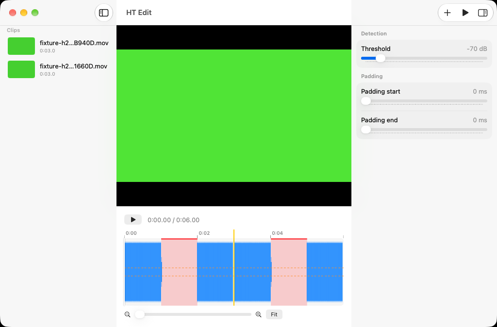
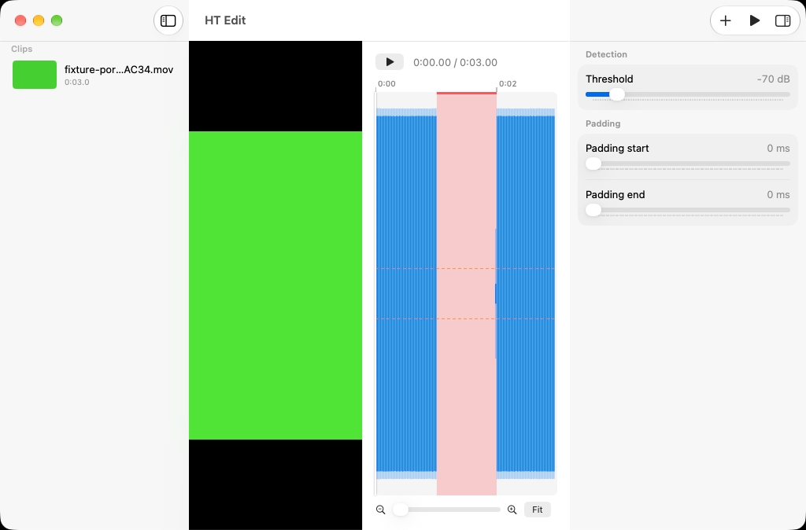
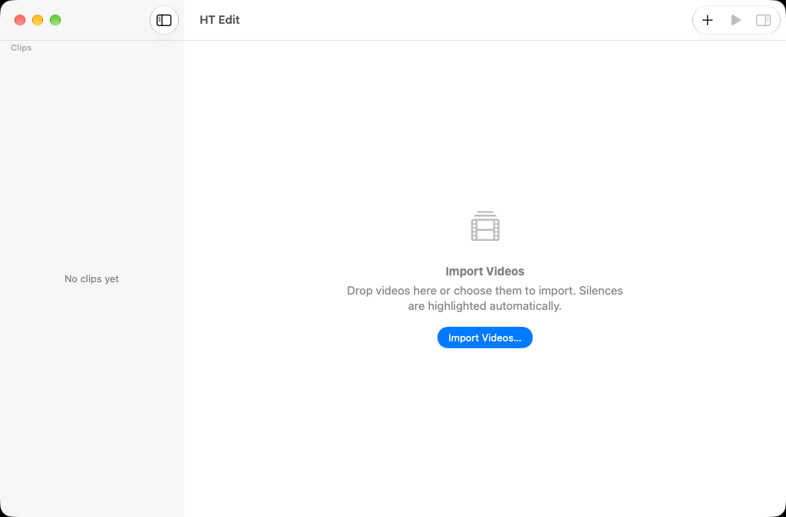

# HT Edit

A native macOS video editor built for Apple silicon. The first feature is **silence detection**: import one or more videos, and every silent stretch is highlighted on the audio waveform right away. You can tune the highlights live, and playback skips the silences.

## Screenshots

Two clips on one timeline. Silences are highlighted on the waveform, and a yellow line marks where the second clip starts:

| Vertical video | Empty editor |
|---|---|
|  |  |

The clips are test videos the app generates itself: solid green frames, with a tone, then silence, then a tone. CI captures these screenshots by running the `ReadmeScreenshots` UI tests. To refresh them, run the **README screenshots** workflow.

## Features

- **Import:** ⌘O, the **+** toolbar button, or drag and drop. You can import several files at once; new clips are added to the end.
- **One seamless timeline:** a yellow line marks where each clip starts.
- **Clip sidebar:** shows each clip's thumbnail, name and length. Drag clips to reorder them. Show or hide it with the system sidebar button.
- **Vertical video:** if the video is taller than it is wide, the player sits beside the timeline instead of above it. This is automatic.
- **Live settings:** threshold (dB), padding start and padding end. Highlights update instantly.
- **Playback:** always skips the highlighted silences.

## Speed

- **Parallel decoding:** each file's audio is split into segments that are decoded concurrently, one reader per core.
- **Progressive waveform:** each segment shows its first windows right away, so the waveform fills in from several places at once.
- **Instant playback:** the timeline and playback are ready as soon as the clip's duration has loaded. The video is drawn with a bare `AVPlayerLayer`.
- **Cache:** finished analyses are stored in the app's Caches folder, so re-importing a file is instant.
- **Warm-up at launch:** a splash screen runs the full import path once on a tiny generated clip. This loads the decoder, the reader, the player and the waveform canvas, so the first real import doesn't pay that cost.

## Architecture

| Layer | File(s) |
|---|---|
| Decode + measure | `Audio/AudioLevelAnalyzer.swift`, `Audio/AudioSegmentPlanner.swift`, `Audio/LevelsCache.swift` |
| Detection | `Analysis/SilenceDetector.swift`, `Model/ClipTimeline.swift` |
| Playback | `Playback/CompositionBuilder.swift` (`AVMutableComposition`; `AVVideoComposition.Configuration` for mixed orientations), `Analysis/PlaybackSkipper.swift` |
| Waveform | `Waveform/WaveformSampler.swift`, `Views/WaveformCanvas.swift` (draws only what's visible) |
| UI | `ContentView.swift`, `Views/*`, `App/WarmUp.swift` |

Project settings: Swift 6, MainActor-by-default, macOS 27.

## Building and testing

Open `HT Edit.xcodeproj` in Xcode, then:
- **⌘R** to run the app.
- **⌘U** to run the unit tests (Swift Testing) and UI tests (XCTest).

### Continuous integration

Every push runs `.github/workflows/ci.yml` on GitHub's `xcode-27` runner (macOS 27, Xcode 27):
- The build treats **all warnings as errors**, so deprecated APIs and concurrency warnings fail CI.
- Unit tests include end-to-end imports of generated H.264, HEVC, portrait and audio-only files. They check that playback becomes ready, that frames are not black, that analysis finishes, and that silences are found.
- UI tests launch the app with `-UITestFixture <kind>` (Debug builds only), which imports a generated file inside the app's sandbox. They check the clip row, that analysis finishes, the video pixels, right-click Delete, the Delete key, and the **+** and Import buttons.

### Diagnostics

The app logs each import stage under the subsystem `ht.edit`, with the categories `import`, `analysis` and `playback`. It also emits signposts ("Analyze audio", "Prepare playback").
- To watch the logs, open Console.app and filter on `subsystem:ht.edit`.
- To see timings, use Instruments ▸ Points of Interest.
- To find re-render loops (Debug builds only), launch with the environment variable `HTEDIT_TRACE_BODIES=1`. Each re-render of the main views is then logged with the reason (SwiftUI's `_printChanges`).
