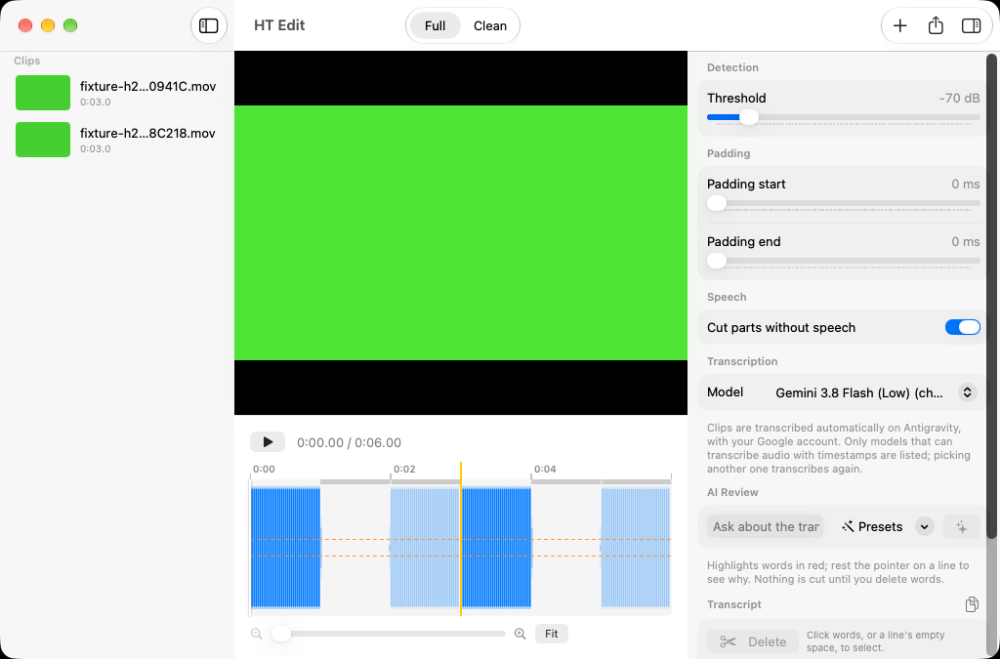
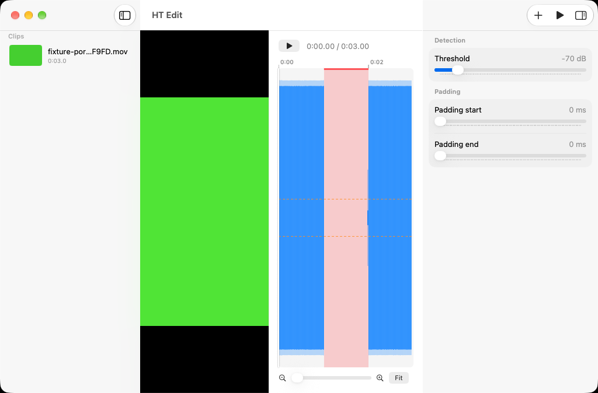
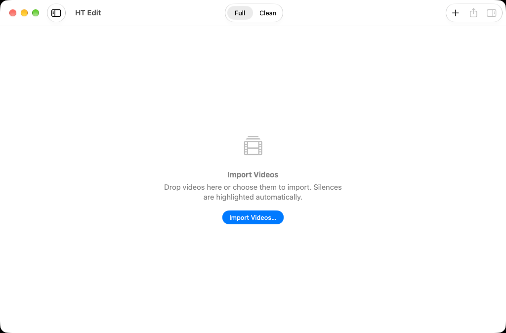

# HT Edit

A native macOS video editor built for Apple silicon. The first feature is **silence detection**: import one or more videos, and every silent stretch is highlighted on the audio waveform right away. You can tune the highlights live, and playback skips the silences.

## Screenshots

Two clips on one timeline. Silences are highlighted on the waveform, and a yellow line marks where the second clip starts:



| Vertical video | Empty editor |
|---|---|
|  |  |

The clips are test videos the app generates itself: solid green frames, with a tone, then silence, then a tone. CI captures these screenshots by running the `ReadmeScreenshots` UI tests. To refresh them, run the **README screenshots** workflow.

## Install

Download `HT-Edit-….dmg` from [Releases](../../releases), open it and drag HT Edit to Applications. It needs macOS 27.

The app isn't notarized by Apple, so macOS blocks it the first time:
1. Open HT Edit once, and click **Done** when macOS says it can't check it.
2. Go to **System Settings → Privacy & Security**, scroll down and click **Open Anyway** next to HT Edit.

Or, in Terminal:

```bash
xattr -dr com.apple.quarantine "/Applications/HT Edit.app"
```

## Features

- **Import:** ⌘O, the **+** toolbar button, or drag and drop. You can import several files at once; new clips are added to the end.
- **One seamless timeline:** a yellow line marks where each clip starts.
- **Clip sidebar:** shows each clip's thumbnail, name and length. Drag clips to reorder them. It's hidden at launch: show it with the sidebar button or **View ▸ Show Sidebar** (⌃⌘S).
- **Vertical video:** if the video is taller than it is wide, the player sits beside the timeline instead of above it. This is automatic.
- **Live settings:** threshold (dB), padding start and padding end. **Padding start** keeps audio just before speech starts, and **padding end** keeps audio just after it ends. The timeline updates instantly.
- **One inspector:** the silence settings are on top and the transcript is right below them, in one scrolling panel with no tabs.
- **Full or Clean:** the switch at the top of the window picks how removed parts show.
  - **Full** shows everything, with removed parts grayed out and cut words struck through.
  - **Clean** leaves them out. The timeline shows only what's kept, back to back, and its time is the edit's time. Cut words, and lines with nothing left, disappear from the transcript.
- **Removed parts look disabled (in Full):** everything playback skips (silences, cut words, and parts without speech) is grayed out on the timeline, at 30% opacity. Each part has its own gray bar along the top, split wherever the reason changes: a pause can read *No speech*, *Silence*, *No speech*. Rest the pointer on a bar to see why that part was removed, with a **Preview** button that plays just that part; the card goes away as soon as the pointer leaves it.
- **Playback:** always skips the removed parts.
- **Automatic transcript with timestamps:** each clip is transcribed as soon as it's imported; there's no button to press. A **Retry** button appears in the inspector only if transcription failed or was cancelled. Each line shows when it was spoken. Click a line's time to jump there. The line that's playing is highlighted, and **Copy** puts the whole transcript, with timestamps, on the clipboard.
- **Only speech is kept:** once a clip's transcript and word timing are done, everything that isn't speech is cut: before the first word, after the last, and every pause of 0.3 s or more between words (0.1 s is kept next to each word). Silences and noises that aren't words go too. Turn it off with **Cut parts without speech** in the inspector's **Speech** section.
- **Cut by deleting words:** click a word in the transcript to select it (and jump there). Shift-click extends the selection and ⌘-click adds or removes one word. Click a line's empty space, not a word, to select the whole line. Then press **⌫**: playback skips the deleted words, and they're struck through and dimmed in the transcript. Press **⌫** again on cut words to put them back, or use **Restore All**.
- **AI Review:** type a question about the transcript in the inspector, or pick one from **Presets**: Find repetition, Pick best parts, Pick worst parts, Grammar check, Filler words, Off-topic.
  - The words it points at turn red. Rest the pointer on a line to see why each one was picked.
  - **Select** selects every highlighted word, so **⌫** cuts them all at once. **Clear** removes the highlights.
  - Nothing is cut until you delete words. It runs on Antigravity, with the model picked for transcription, and sends only the transcript text, never the audio.
- **Export to Final Cut Pro:** the **Export** button in the toolbar saves the edit as an `.fcpxml` file (FCPXML 1.10).
  - It holds one project with a clip for each kept piece, pointing at your original files. Markers come along too.
  - Cuts are rounded to the nearest video frame, and the file's start timecode is respected.
  - Final Cut Pro, DaVinci Resolve and other editors can open it.
- **Markers:** press **M** to drop a blue marker at the playhead.
- **Keyboard:** **Space** plays and pauses, **M** adds a marker and **⌫** cuts or restores the selected words, whatever has focus, except while typing in a text field. (While the clip sidebar has focus, ⌫ still deletes clips.)
- **Smooth scrolling during playback:** the timeline pages along with the playhead, but once you scroll it yourself it stays where you put it until you start playback again.
- **Zoom:** pinch on the trackpad, or use the zoom bar under the timeline: a logarithmic slider, **−**/**+** and **Fit**. Zooming keeps the playhead (or the middle of the view) in place.

## Transcription

Transcription runs through your own **Antigravity CLI (`agy`)**, under your Google account and subscription. There are no API keys, and nothing is charged per request. (Gemini CLI no longer serves individual accounts; Antigravity CLI replaced it.)

**One-time setup:** install the Antigravity CLI and sign in once with your Google account (run `agy` in Terminal). That's all.

**Every time:** nothing to do. Each clip is transcribed as soon as it's imported.
- Optional: pick another **model** in the inspector's **Transcription** section. Only models that can transcribe audio with timestamps are listed, and the cheapest one your account offers is selected by default. Your choice is remembered, and picking another model transcribes the clips again.
- If something goes wrong (Antigravity isn't signed in, or a part failed), the tab says why and shows **Retry**.

How it works:
- Each clip's audio is cut into 3-minute chunks (`.m4a`).
- HT Edit runs `agy -p … --output-format json --json-schema …` on two chunks at a time.
- The timestamped segments are placed on the timeline as they arrive.
- A failed chunk is retried once; anything that still fails can be retried on its own.
- Finished transcripts are cached per file and model. Importing the same file again shows the text at once. If its word times were estimated, only the word timing runs again, not the transcription.

### Word timing

Gemini gets the words right, but it only guesses when each word was said. To cut single words cleanly, HT Edit measures word times on the audio itself, using **forced alignment**. The text is already known, so the aligner only has to find where each word sits in the waveform. It uses Meta's MMS alignment model, which covers 1,100+ languages, Arabic included, and listens in 20 ms frames.

**One-time setup:** install [uv](https://docs.astral.sh/uv/): `brew install uv`, or `curl -LsSf https://astral.sh/uv/install.sh | sh`. That's all. On the first transcription, uv downloads its own private Python and PyTorch, and the model downloads from Hugging Face (about 2–3 GB in all, into their caches). It never uses or changes the Python on your Mac. Later runs work offline. Without uv, word times are estimated from each line's time (shown with a dotted underline). Downloads check certificates against your Mac's own trust store (the same as Safari), not Python's bundled list.

How cuts are placed:
- Word times from an aligner are good to a few tens of milliseconds. In connected speech, and especially in Arabic, there often isn't an exact boundary between two words anyway.
- So a cut doesn't sit on a word's edge. It moves to the **quietest 10 ms** in the pause before the first deleted word, and again in the pause after the last one. The join then falls where there's the least sound to break, and there's no crossfade.
- When the deleted words run straight into their neighbors with no pause, the cut still goes to the quietest point it can find.

To check word timing by hand, run `zsh scripts/align-probe.sh`. It runs the exact command HT Edit uses (`uv run --script align.py …`) on a short spoken clip.

To check your installation by hand, run `zsh scripts/agy-probe.sh`. It runs the exact command HT Edit uses on a short clip with speech.

Running `agy` and reading your sign-in means HT Edit runs **without the App Sandbox**. Distribute it signed and notarized, outside the Mac App Store. Hardened runtime stays on.

## Speed

- **Parallel decoding:** each file's audio is split into segments that are decoded concurrently, one reader per core.
- **Progressive waveform:** each segment shows its first windows right away, so the waveform fills in from several places at once.
- **Instant playback:** the timeline and playback are ready as soon as the clip's duration has loaded. The video is drawn with a bare `AVPlayerLayer`.
- **Cache:** finished analyses are stored in the app's Caches folder, so re-importing a file is instant.
- **Warm-up at launch:** a splash screen runs the full import path once on a tiny generated clip. This loads the decoder, the reader, the player and the waveform canvas, so the first real import doesn't pay that cost.

## Architecture

| Layer | File(s) |
|---|---|
| Decode + measure | `Audio/AudioLevelAnalyzer.swift`, `Audio/AudioSegmentPlanner.swift`, `Audio/LevelsCache.swift` |
| Detection | `Analysis/SilenceDetector.swift`, `Model/ClipTimeline.swift` |
| Playback | `Playback/CompositionBuilder.swift` (`AVMutableComposition`; `AVVideoComposition.Configuration` for mixed orientations), `Analysis/PlaybackSkipper.swift` |
| Waveform | `Waveform/WaveformSampler.swift`, `Views/WaveformCanvas.swift` (draws only what's visible) |
| Transcription | `Transcription/AgyEngine.swift` (runs `agy`, parses its JSON), `Transcriber.swift` (chunks, concurrency, retries), `AudioChunkExporter.swift`, `TranscriptionController.swift`, `TranscriptionModel.swift` (model catalog), `TranscriptCache.swift`, `Model/Transcript.swift` |
| Word timing and cuts | `Transcription/WordAligner.swift` (runs `align.py` through `uv`), `Transcription/align.py` (MMS forced alignment), `Model/TranscriptWords.swift`, `Model/WordCuts.swift` (cuts snapped to the quietest point of each pause), `Model/NonSpeech.swift` (what isn't speech), `Model/RemovedRanges.swift` (everything removed, and why) |
| Clean layout | `Model/EditMap.swift` (what's kept, back to back: maps the full timeline to the edit) |
| AI review | `Transcription/TranscriptReview.swift` (presets, highlights), `AgyEngine.swift` (`review`: runs `agy` on the transcript text) |
| Export | `Model/EditDecisions.swift` (each clip's kept pieces), `Export/FCPXMLExporter.swift` (FCPXML 1.10, frame-snapped, start timecode) |
| UI | `ContentView.swift` (toolbar: Full/Clean, Export), `Views/*` (including `InspectorView`, `SilenceSections`, `TranscriptSections`, `EditorKeyMonitor` for Space/M/⌫, `TimelineZoom`), `Model/Marker.swift`, `App/WarmUp.swift` |

Project settings: Swift 6, MainActor-by-default, macOS 27.

## Building and testing

Open `HT Edit.xcodeproj` in Xcode, then:
- **⌘R** to run the app.
- **⌘U** to run the unit tests (Swift Testing) and UI tests (XCTest).

### Continuous integration

Every push runs `.github/workflows/ci.yml` on GitHub's `xcode-27` runner (macOS 27, Xcode 27):
- The build treats **all warnings as errors**, so deprecated APIs and concurrency warnings fail CI.
- Unit tests include end-to-end imports of generated H.264, HEVC, portrait and audio-only files. They check that playback becomes ready, that frames are not black, that analysis finishes, and that silences are found.
- Transcription tests run the real `agy` runner against fake `agy` scripts: success, signed out, errors, hangs, cancellation and large output. They also cover the chunking, the limit of two requests at a time, the retry and the cache, using real exported audio. CI has no Google sign-in, so a real transcription is checked by hand with `scripts/agy-probe.sh`.
- UI tests launch the app with `-UITestFixture <kind>` (Debug builds only), which makes the app generate and import a file, and with `-UITestFakeTranscription 1`, so a built-in fake stands in for Antigravity (imports transcribe automatically). They check that the sidebar starts hidden, the clip row, that analysis finishes, the video pixels, right-click Delete, the Delete key, Space while the clip list has focus, the **+** and Import buttons, and that the transcript fills in by itself.
- The shared test model is one constant, `testModelID` in `HT EditTests/TestSupport.swift`.

### Releases

`.github/workflows/release.yml` builds the app on GitHub and attaches a `.dmg` and a `.zip` to a GitHub Release. It's ad-hoc signed, so no Apple developer account is needed. To publish a version, push a new tag (use a higher number each time):

```bash
git tag v0.2.0 && git push origin v0.2.0
```

Or open the **Actions** tab, pick **Release**, click **Run workflow**, choose the branch and type a tag such as `v0.2.0`. The tag is created on that branch's latest commit. Either way, the release shows up under **Releases** a few minutes later, with `HT-Edit-<tag>.dmg` and `.zip` attached.

### Diagnostics

The app logs each import stage under the subsystem `ht.edit`, with the categories `import`, `analysis` and `playback`. It also emits signposts ("Analyze audio", "Prepare playback").
- To watch the logs, open Console.app and filter on `subsystem:ht.edit`.
- To see timings, use Instruments ▸ Points of Interest.
- To find re-render loops (Debug builds only), launch with the environment variable `HTEDIT_TRACE_BODIES=1`. Each re-render of the main views is then logged with the reason (SwiftUI's `_printChanges`).
